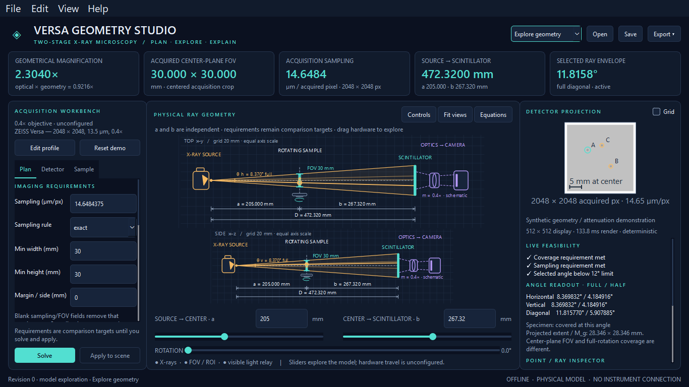

# Versa Geometry Studio

A local Python/Qt desktop companion for planning and teaching two-stage X-ray microscopy geometry. It calculates camera → scintillator → object sampling, finds feasible source/scintillator distance pairs, and links physical rays to a deterministic synthetic detector projection.



## Download and run on Windows

**[Download Versa Geometry Studio v1.0.0 for Windows (64-bit)](https://github.com/alidarbandi/versa-geometry-studio/releases/download/v1.0.0/VersaGeometryStudio-v1.0.0-windows-x64.zip)**

You can also visit the **[latest release](https://github.com/alidarbandi/versa-geometry-studio/releases/latest)** to see the available downloads, release notes, and SHA-256 checksum.

1. Download **`VersaGeometryStudio-v1.0.0-windows-x64.zip`** from the release's **Assets** list.
2. Right-click the downloaded ZIP in File Explorer and choose **Extract All**.
3. Open the extracted **`VersaGeometryStudio`** folder.
4. Double-click **`VersaGeometryStudio.exe`**.

No Python installation, terminal command, or internet connection is needed to run the Windows build. Keep **`_internal`** beside the executable; move the whole folder together. Example plans and profiles are also included in their own folders in the download. The **Open** button in the app starts in its bundled examples folder.

This portable x64 build was built and launched on **Windows 11, build 26100**. Qt 6.11 supports Windows 10 **1809 or later**; this delivery has not been tested on Windows 10 and does not support Windows 10 LTSB 1607. The build is unsigned. The automatic **Source code (zip)** download on GitHub contains Python source rather than the runnable Windows application.

To verify a download, compare its SHA-256 with `SHA256SUMS.txt` from the same release:

```powershell
Get-FileHash .\VersaGeometryStudio-v1.0.0-windows-x64.zip -Algorithm SHA256
```

## Run from the source checkout

Clone or download this repository, open a terminal in its root directory, and follow **Fresh installation** below. To clone:

```powershell
git clone https://github.com/alidarbandi/versa-geometry-studio.git
cd versa-geometry-studio
```

Double-click **`Launch-Versa-Geometry-Studio.cmd`**, or run the tested source environment from this directory:

```powershell
.\.venv\Scripts\python -m versa_geometry_studio
```

After building, the standalone application is **`dist\VersaGeometryStudio\VersaGeometryStudio.exe`**. Keep its entire folder together; the executable depends on its `_internal` directory. Python is unnecessary for that packaged version. The launcher prefers the packaged app when present.

Open an example directly:

```powershell
.\.venv\Scripts\python -m versa_geometry_studio examples\04-interior-roi-crop.json
```

No server, account, internet connection after installation, GPU, CUDA, or microscope connection is used.

## Fresh installation

Use a clean 64-bit CPython environment. This build was tested with **Python 3.12.13**, **PySide6/Qt 6.11.1**, **NumPy 2.2.6**, **pytest 9.1.1**, and **PyInstaller 6.22.3** on **Windows 11 Enterprise, build 26100**. `requirements-tested.txt` records the complete tested environment. The code supports Python 3.10+. A clean CPython environment is recommended to avoid conflicts with Qt DLLs supplied by other Python distributions.

With a regular CPython installation:

```powershell
python -m venv .venv
.\.venv\Scripts\python -m pip install -e ".[dev]"
.\.venv\Scripts\python -m versa_geometry_studio
```

With [uv](https://docs.astral.sh/uv/):

```powershell
uv python install 3.12
uv venv --python 3.12 .venv
uv pip install --python .venv\Scripts\python.exe -e ".[dev]"
.\.venv\Scripts\python -m versa_geometry_studio
```

Linux development uses the same source, with `.venv/bin/python` in place of the Windows path. Install the Qt/X11 runtime libraries required by your distribution. Headless tests can use `QT_QPA_PLATFORM=offscreen`. Linux execution has not been tested here.

Qt 6.11 lists **Windows 10 1809 or later** and Windows 11 for x86-64. **Windows 10 LTSB 1607 is outside that supported range** and needs a separate compatibility decision; this package does not claim to support it. Consult the [version-matched Qt platform requirements](https://doc.qt.io/qt-6.11/supported-platforms.html). Windows 10 and Linux are targets, not platforms on which this delivery was executed.

## Workflows

* **Explore geometry:** source distance `a` and scintillator distance `b` are independent inputs. Drag the sliders, use arrow keys for 0.01 mm adjustments, enter precise numbers, or drag the source/scintillator in either diagram. Imaging requirements stay visible as comparison targets.
* **Plan acquisition:** enter exact or no-coarser-than sampling, optional minimum width/height, margin per side, angle convention, and optional fixed `a`, `b`, or `D`. Blank optional fields remove the requirement. Press **Solve acquisition**, review the explanation, and **Apply candidate to scene**. Editing a requirement never silently overwrites the geometry. A change invalidates an earlier candidate.
* **Lock magnification:** changing either distance derives the other using `b=(M_g−1)a`. Sampling and FOV remain constant while angles change.
* **Lock total separation:** changing either distance derives the other using `b=D−a`. Only positive, valid source/sample/scintillator configurations are committed. A single mode selector makes conflicting locks impossible.

Undo/redo covers committed changes. A slider or hardware drag is one history transaction. Invalid or incomplete numerical text leaves the last valid scene in place and shows local validation. **Reset demo** restores the original model.

**Detector** contains native camera dimensions, chip pitch, optical scale, usable area, binning, crop and parity. Changing the objective loads that objective's separate calibration, crop and restrictions. The four nominal choices are offered with their availability explicitly **unconfigured**. An objective marked unavailable cannot produce a solver recommendation.

**Sample** contains independent width `y`, height `z`, beam depth `x`, offsets, rotation about `z`, and illustrative attenuation coefficients. It offers cuboid and ellipsoid phantoms with three disjoint internal inclusions. Interior ROI size, local offset and truncation are separate from the outer specimen. The ROI is a geometric target box; containment within the phantom is not inferred or required.

**Assess 0–360° coverage** runs in a worker. It evaluates exact per-angle cuboid/ellipsoid bounds at the displayed increment, then refines near the worst sampled angle at one tenth of that increment. This remains a **sampled assessment**, not a rigorous continuous-rotation guarantee. A 30 mm transverse square can need 42.42640687 mm even in the parallel-ray limit. The 28 × 28 × 5 mm demo also has modest perspective effects over rotation.

Hover over the detector to highlight the corresponding ray in both views and inspect its host/inclusion path lengths. Click inclusion A, B or C in either view or the detector to inspect its perspective projection. Wheel zooms, middle-drag pans, and **Fit views** restores the view without changing geometry. **Controls** collapses the left panel. **View** contains theme, precision, and extra specimen-ray controls. The optional grid is visibly a display grid, decimated to at most 64 divisions.

## Physics and conventions

`physics.py` is the single source of derived numerical results. UI, solver, persistence, and exports consume it.

| Quantity | Definition |
|---|---|
| Rotation center | `(0,0,0)` |
| Source | `S=(-a,0,0)`, `a>0` |
| Active scintillator plane | `x=b`, `b>0` |
| Detector horizontal / vertical | physical `y` / `z` |
| Separation | `D=a+b` |
| Geometrical magnification | `M_g=D/a=1+b/a` |
| Object-to-camera magnification | `M_total=m M_g` |
| Equivalent scintillator field | `W=N_usable p/m` |
| Acquired sampling | `Δ=k p/(m M_g)` |
| Full usable FOV | `W/M_g=N_out Δ` |
| Acquired crop FOV | `C_out Δ` |
| Point projection | `t=D/(a+x)`; scintillator `(b,t y,t z)` |
| Half-angle | `α=atan(R/D)` |
| Full opening | `θ=2α` |

Geometry uses **millimetres** and trigonometry **radians** internally. Camera pitch and sampling display in **µm** and **µm/pixel**, angles in **degrees**. Sampling is acquired information spacing, not measured spatial resolution. Reconstruction resampling cannot create additional information.

For the baseline native 2048 × 2048 camera, 13.5 µm pitch and nominal `m=0.4`, chip width is **27.648 mm** and equivalent scintillator width **69.12 mm**. At `a=205 mm`, `b=267.32 mm`, the model gives **M_g=2.304**, **30 mm FOV**, **14.6484375 µm/pixel**, and **11.815770331° full diagonal** opening. The 12° default is a **user planning constraint**, not a ZEISS specification.

Binning alone preserves full-sensor FOV and reduces the output count. A crop reduces acquired FOV. Explicit usable camera dimensions refer to a centered calibrated rectangle; an optional scintillator image-circle diameter further limits it to a centered inscribed rectangle. Incomplete edge bins are conservatively discarded, so a calibrated circle can lose a partial edge bin when binning changes.

Pixel indices refer to the **usable** centered frame: `u=y_camera/(k p)+(N_x,out−1)/2`, with analogous physical-up `v`. Crop indices have their own center. Physical edges at `±W/2` determine clipping; the first center is one half pixel inside the edge. Display rows run downward independently of physical `z`. Optical flips affect camera mapping and preview orientation, not X-ray intersections.

The horizontal/vertical radii are half the appropriate scintillator width/height. The diagonal radius is `sqrt(Wx²+Wy²)/2`, describing the circular cone through the detector corners. Full and half values appear together. The selected constraint explicitly chooses **horizontal, vertical or diagonal**, **full or half**, and **full active area or acquired crop**. Orthographic arcs represent their own horizontal/vertical plane and adopt the selected full/half convention. A diagonal constraint is a 3D corner cone, not an angle inferred from one side view. The actual emitted/collimated source cone is unknown.

Both physical axes within each orthographic view use equal scale. Hardware housings and the visible-light relay are schematic. **X-rays stop at the scintillator**; the violet relay never enters X-ray angle or distance calculations.

## Solver

Coverage bounds magnification above: `M_g ≤ min(Wx/Lx, Wy/Ly)`, using the acquired crop width when a crop is configured. No-coarser sampling bounds it below: `M_g ≥ k p/(m Δ_target)`. Exact sampling fixes the ratio. Coverage lengths include twice the per-side margin.

The problem can be solved without a numerical magnification grid: these ratio bounds, confirmed physical bounds, angular separation, fixed distances, and verified affine stage constraints are **linear half planes in `(a,b)`**. Pairwise boundary intersections produce deterministic candidates. Minimum separation uses the smallest `a+b`; the closest-to-current goal adds orthogonal projections and minimizes squared Euclidean distance in mm. Ties honor exact locks, minimum D, finest sampling consistent with coverage, then proximity to the current pair. This is geometry, not an exposure/SNR optimization.

For fixed magnification, the source interval is also reported:

```text
a_low  = max(a_min, b_min/(M_g−1), D_min/M_g, D_angle_min/M_g)
a_high = min(a_max, b_max/(M_g−1), D_max/M_g)
```

Missing bounds are omitted. Confirmed source/sample and scintillator/sample clearances include a conservative full-rotation specimen envelope. The sample must also lie strictly between the source and detector planes at the current angle. Hardware clearances and specimen truncation remain separate questions.

The equality boundary `D=R/tan(α_limit)` is reported separately. A recommendation subtracts the configurable buffer **in the chosen full/half convention**, then converts to half-angle radians. A positive buffer makes the recommended boundary satisfy the original strict limit. With zero buffer, an unattained strict minimum is returned as a **distance family**, rather than inventing an epsilon. The same applies when no positive minimum exists. Set a fixed distance, separation, positive angular buffer, or confirmed physical lower bound to choose a pair. `M_g=1` is an explicit zero-detector-distance limiting case, not a permitted positive-distance solution.

Algebra comparisons use relative tolerance `1e−9`, half-plane feasibility `1e−7 mm`, and strict-angle comparisons `1e−9 degrees`. Rounded reference angles use `1e−6 degrees` in tests. Very ill-conditioned or extreme unphysical inputs may require practical local bounds; the app rejects nonfinite values instead of silently creating invalid geometry.

At 30 mm and 10 µm, **3000 acquired pixels** are required; 2048 cannot supply both. Exact 10 µm sampling gives `M_g=3.375` and **20.48 mm** full FOV. The solver explains this and suggests coarser sampling, smaller field, another calibrated configuration, or an explicitly separate stitching strategy. It never treats binning/interpolation as missing acquired pixels.

## Profiles and calibration

`profiles/zeiss-versa-nominal.json` is a demonstration profile, not a validated configuration of the installed microscope. **Edit profile** offers:

* A physical bounds table with value in mm, confirmation, provenance, source/version and date.
* Signed affine stage-separation mapping coefficients, reference record, and verification state.
* Full per-objective calibration JSON for camera/usable area, optical parity, availability, physical bounds and provenance.
* Notes and an optional user-supplied focal spot diameter; object-space penumbra is the approximate `f (M_g−1)/M_g`, not a true resolution prediction.

Every objective owns its calibration. Provenance records identify **user supplied**, **nominal**, **calibrated**, or **reference**, with units and confirmation. Main-panel detector edits acquire user-supplied provenance. Known nominal values do not imply independent calibration.

The **135 mm** value is recorded as an **unconfirmed legacy stage-coordinate reference** from ZEISS guide v11.x, Table 2-3, for the 0.4× objective. It is applied only when both the rule is locally confirmed and the mapping

```text
documented_signed_stage_separation_mm = c_a*a_mm + c_b*b_mm + offset_mm
```

is verified against a reference. No signs or offsets are guessed. The rule does not become `D≥135 mm` automatically. It does not apply to the other nominal objectives. Table H-6 is the provenance for the supplied legacy detector dimensions and pitch.

Obtain actual travel, sample clearances, objective collision rules, objective availability, usable optical area, distance offsets and net optical factor from the current local instrument documentation, service/calibration records, and exported acquisition metadata. These values remain **unconfigured** here. The 0.1–500 mm illustrative sliders are exploration controls, not manufacturer travel limits; typed values can extend them. Source spot, source emission aperture and relay spacing are also unknown.

`effective_optical_factor()` supports the empirical calibration relationship `m_eff=k p/(Δ_cal M_g)` for a known acquisition. Retain its reference record and validate it against additional acquisitions. There is no undocumented TXRM/XRM importer or guessed vendor metadata mapping.

## Synthetic projection and performance

The noise-free preview traces finite source-to-scintillator rays through the rotated cuboid/ellipsoid using analytic slab/quadratic intersections. Three disjoint spherical inclusions lie inside the host. Optical depth is:

```text
τ = μ_host ℓ_host + (μ_inclusion−μ_host) ℓ_inclusion
I/I0 = exp(−τ)
```

The inclusion difference replaces host attenuation, including when an inclusion is less attenuating. Coefficients are editable in mm⁻¹. This is a **synthetic geometry/attenuation demonstration**, not a calibrated polychromatic instrument prediction. Spectrum, material tables, scatter, phase contrast, scintillator response and PSF are not modeled.

Geometry and numerical results update immediately. NumPy projections run in a worker at 256 display columns during changes and refine to 512 after a 240 ms debounce. Display resolution never changes the acquisition's native/binned pixel count. A single pending render is coalesced to the newest state, results are tagged with revisions, and stale results are discarded. An updating frame is shown rather than presenting an obsolete transmission image as current; markers/physical rays always follow current geometry. A sweep also runs in a worker and is invalidated by state changes. Qt GUI objects are updated only on the GUI thread.

Measured workstation results and reproducible acceptance checks are in [`artifacts/verification.json`](artifacts/verification.json). Measurements are local observations, not universal frame-rate claims. The software QPainter renderer is the default; OpenGL is unnecessary.

## Persistence and exports

**File → Save** writes versioned UTF-8 JSON with all inputs, units, requirements, solver goal, instrument/objective calibration and provenance, phantom/ROI, angle convention, mode and computed results at full precision. Loading validates units and inputs, recomputes derived results, and warns if saved results differ. Writes replace the destination atomically.

**Export** supports:

* Dimensioned **PNG and SVG geometry**, both orthographic views and the selected angle convention.
* **Raw or annotated synthetic detector PNG** at preview display resolution. The raw image represents the full usable active area; the annotated panel includes crop outline/shading, markers and scale bar. It is not a native-count acquisition file.
* **CSV/JSON parameter tables** with units; JSON also embeds the full plan.
* A **Markdown planning summary** with equations, active constraints, current distances, specimen/ROI coverage, assumptions and full profile provenance.

**Edit → Copy parameter table** places a tab-separated unit-bearing table on the clipboard. Theme, display precision and last imported profile path persist in local Qt settings. Plans are never sent to another service.

Examples:

| Plan | Purpose |
|---|---|
| `01-demo-30mm.json` | Original 205 / 267.32 mm demo |
| `02-vertical-vs-diagonal.json` | 150 / 195.6 passes 12° full vertical, fails diagonal |
| `03-binning2-same-field.json` | 1024² output, 29.296875 µm sampling, unchanged FOV |
| `04-interior-roi-crop.json` | 15 mm acquired crop, outer truncation vs covered target |
| `05-infeasible-3000-pixels.json` | Quantitative 30 mm / 10 µm infeasibility |
| `06-rotating-ellipsoid.json` | Depth, perspective, rotation, and interior ROI |

## Tests, screenshots, packaging

```powershell
.\.venv\Scripts\python -m pytest -q
.\.venv\Scripts\python tools\create_examples.py
.\.venv\Scripts\python tools\verify_app.py
```

The acceptance script opens **actual native Qt windows**, changes sliders/modes/rotation, solves and applies, runs a sweep, saves/loads and exports, and captures screenshots at **1366 × 768** and **1920 × 1080**. It fixes DPI rounding to 1 for reproducible image dimensions; the application itself retains Qt high-DPI support. Screenshots in `artifacts/` include dark/light themes, rotation, and an infeasible plan. Interaction tests send Qt input events; the visual layout was also inspected from those screenshots.

All **67 tests** passed for v1.0.0. They cover independently supplied numerical fixtures, angle equality and buffer conventions, binning/crop invariants, infeasibility, confirmed/unknown hardware bounds, mapped stage constraints, open minima, near-unit magnification, perspective, clipping, optical parity, analytic intersections, transmission replacement, inclusion containment/disjointness, finite-rotation coverage, serialization/unit validation, GUI synchronization, stale renders, lock invariants, undo/redo, profile editing, exports and responsive layouts.

Build natively on Windows:

```powershell
.\build-windows.ps1
```

This runs tests, builds `packaging/VersaGeometryStudio.spec`, and launches the resulting Windows executable for a screenshot smoke test. Equivalently:

```powershell
.\.venv\Scripts\python -m PyInstaller --noconfirm packaging\VersaGeometryStudio.spec
.\dist\VersaGeometryStudio\VersaGeometryStudio.exe --smoke-test artifacts\packaged-smoke.png
```

The delivery was built and smoke-tested **on Windows 11**. The app is unsigned. The one-folder bundle retains dynamically linked Qt libraries and includes third-party license notices.

To create the portable release ZIP after building:

```powershell
.\.venv\Scripts\python tools\package_release.py
```

This puts the Windows download and `SHA256SUMS.txt` in `release/`. It includes the complete application folder, examples, profiles, README, and license notices. Third-party source locations and license copies are recorded in [THIRD_PARTY_NOTICES.md](THIRD_PARTY_NOTICES.md) and `third_party_licenses/`. The published release is tied to the `v1.0.0` source tag.

If the existing app is running, build into a separate folder:

```powershell
.\build-windows.ps1 -OutputDirectory release\build
.\.venv\Scripts\python tools\package_release.py --build-dir release\build\VersaGeometryStudio
```

## Architecture and sources

The package separates `models`, `physics`, `solver`, `projection`, `renderer`, `controller`, `scene`, `preview`, `controls/theme`, `profile_editor`, and `persistence`. Numerical modules import no Qt. `app.py` composes the desktop widgets.

Primary references:

* [Manufacturer-authored legacy ZEISS Versa guide v11.x, Purdue-hosted](https://www.physics.purdue.edu/xrm/new-users/training/Xradia_Versa_Users_Guide_v11x_510.pdf), Tables H-6 and 2-3. The supplied URL was inaccessible to the documentation browser during this build; nominal/reference values were retained from the provided specification and marked for local confirmation. The current installed instrument manual was not supplied.
* [ZEISS two-stage magnification technical note, January 2021](https://asset-downloads.zeiss.com/catalogs/download/mic/02632a56-567c-4a98-b8a7-e9bd31e3f5cc/APAC-only_EN_wp_expanding_boundaries_3D_X-ray_Versa_515.pdf), especially Figure 2: scintillator conversion followed by optical magnification. Its architecture was consulted; its model-specific performance specifications were not imported into this profile.
* [ZEISS Versa product portal](https://www.zeiss.com/microscopy/en/products/x-ray-microscopy/versaxrm.html) for locating the correct local model's documentation.
* [Qt for Python QGraphicsView](https://doc.qt.io/qtforpython-6/PySide6/QtWidgets/QGraphicsView.html), [deployment guidance](https://doc.qt.io/qtforpython-6/deployment/deployment-pyside6-deploy.html), and [Qt 6.11 supported platforms](https://doc.qt.io/qt-6.11/supported-platforms.html).
* [NumPy 2.2 documentation](https://numpy.org/doc/2.2/), [pytest documentation](https://docs.pytest.org/), and [PyInstaller usage](https://pyinstaller.org/en/stable/usage.html).

This software is an independent planning and teaching tool. It neither controls nor claims manufacturer validation of a microscope.
